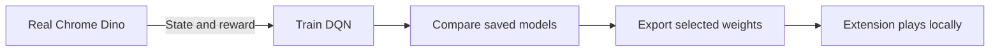
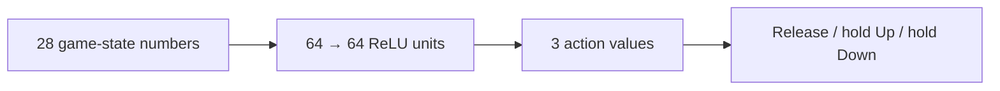
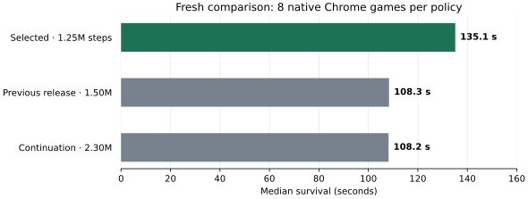

# Dino RL

Train a small reinforcement learning model to play **Chrome’s own Dinosaur game**, then run it locally with a Chrome extension. The model learns from its own attempts; you do not need to record yourself playing.

**Try it:** load the [`extension/`](extension/) folder in Chrome. Python is needed only for training and evaluation.



## Play with the extension

Tested on **Chrome 157.0.8103.79, macOS**. The extension requires Chrome 157 or later; later versions are not verified.

1. Download or clone this repository and keep the folder on your computer.
2. Open `chrome://extensions` and enable **Developer mode**.
3. Click **Load unpacked** and select this repository’s **`extension`** folder.
4. Open **Dino RL** from the Chrome toolbar and click **Open Dino**.
5. Keep the game tab in front and click **Start AI** in its control panel.

**Updating an existing installation:** first update your local files with `git pull`, or download the new repository files into the folder you originally loaded. Close the old game tab, click Reload on Dino RL in `chrome://extensions`, then open a new game. The panel should show **step 1,250,400**; the extension version is **0.2.0**.

| Control | Result |
|---|---|
| Start AI | Let the saved model play |
| A key, click outside the button, or scroll in the page | Pause AI; your input can reach the game |
| Switch tabs or leave the window | Pause AI |
| Resume / Restart with AI | Explicitly give control back |
| Return to Dino | Focus the existing game; stay paused |
| Disconnect / cancel Chrome’s debugging banner | Stop automated input |

**Why `dino.invalid`?** Chrome blocks extension control of `chrome://dino`. The extension puts only its own new tab offline and navigates to this reserved placeholder address. Chrome supplies the real offline game; it is not an external game website. Other tabs remain online.

The extension needs **debugger** permission, so Chrome shows a permission warning and debugging banner. The code attaches only to the game tab it creates. Model inference is local: no server, account or analytics. Office policies may prohibit this access; the extension does not bypass them.

## The model and its results



The model sees speed, dinosaur movement, its previous action and the nearest two visible obstacles. Running is automatic. Holding and releasing Up lets it learn jump duration. It chooses an action about every **50 ms**. There are no hand-written obstacle avoidance rules.

The bundled **1,250,400-step** policy came from a run that started with random weights. It led a new comparison of three saved policies on the same Chrome version:

| Candidate | Games | Median survival | Mean score |
|---|---:|---:|---:|
| **Selected: 1,250,400 steps** | 8 | **135.1 s** | **2,069.9** |
| Previous release: 1,500,576 steps | 8 | 108.3 s | 1,450.6 |
| Continuation: 2,297,656 steps | 8 | 108.2 s | 1,606.3 |



These are small, background, native-speed **selection** samples with different random obstacles and a 300-second cap. None reached the cap. The model still crashes, including on birds. More training did not consistently help; the five-million-step study stopped at **4,198,264 saved steps** after native rendering stalled. It did not finish its target. In three separate extension games, **two reached the five-minute test cap**; scores were **5,564, 5,564 and 5,293**. See the [model card](models/README.md) for conditions and limitations.

## Train or evaluate

Install **Python 3.12**, [uv](https://docs.astral.sh/uv/getting-started/installation/) and desktop Google Chrome. Use **Node.js 24+** for the policy tests. From the repository root:

```bash
uv sync --frozen
uv run --frozen dino check
uv run --frozen dino train --run runs/my-first-run --workers 1 --steps 20000
```

For the longer recipe, stopping/resuming, browser updates and TensorBoard, follow the [training guide](docs/training.md). Sleep suspends local training. The program does not change laptop power settings. More workers use more resources; there is no hard CPU percentage cap.

Evaluate the bundled model without changing weights:

```bash
uv run --frozen dino evaluate --checkpoint models/best.json --episodes 10
uv run --frozen dino play --checkpoint models/best.json --episodes 3
```

`evaluate` uses a background browser; `play` shows it. Both create isolated profiles and save JSON reports under ignored `runs/`. Python requires the Chrome version recorded in the model contract. Only load Python model/replay files you trust.

## Repository map

| Directory | Contains |
|---|---|
| [`dino_rl/`](dino_rl/) | Game environment, DQN training, evaluation, checkpoints and telemetry |
| [`extension/`](extension/) | Installable extension and exported policy |
| [`models/`](models/) | Small inference ZIP, provenance, measured results and model card |
| [`configs/`](configs/) | Reusable training arguments |
| [`scripts/`](scripts/) | Python-to-browser policy export |
| [`tests/`](tests/) | Algorithm contracts, export parity and native Chrome controls |
| [`docs/`](docs/) | Simple guides, diagrams and review record |
| `runs/` | Local replay, checkpoints, logs and raw reviews; **ignored by Git** |

The ZIP serves Python and the JSON serves the extension. Both are required formats of the same policy; full learning checkpoints are not published.

## Development checks

```bash
uv sync --frozen --group dev
uv run --frozen ruff check .
uv run --frozen ruff format --check .
uv run --frozen python -m unittest discover -s tests
npm test
uv run --frozen pip-audit
DINO_BROWSER_TESTS=1 uv run --frozen python -m unittest discover -s tests -p test_extension_browser.py -v
```

CI runs Python, JavaScript and formatting checks. Native Chrome checks run separately in temporary local profiles. Their extension-loading flag applies only to tests.

Read [how DQN works](docs/how-it-works.md), the [extension design](docs/extension-design.md), or the [review record](docs/review.md).

## License

Code and released model: [MIT](LICENSE). Chrome and its Dinosaur game remain Google/Chromium software; their code and artwork are not bundled.
