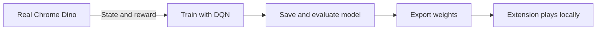

# Dino RL

A small reinforcement learning project that learns to play **Chrome’s own Dinosaur game**. Python trains a DQN model from its own attempts. A Chrome extension runs the saved model locally and lets you take control at any time.

**Try the trained model:** load the [`extension/`](extension/) folder in Chrome. You do not need Python to use it.



[Install the extension](#play-with-the-chrome-extension) · [Train a model](#train-a-model) · [Read the graphs](#read-the-training-graphs) · [How DQN works](docs/how-it-works.md) · [Model results](models/README.md)

For an explorable diagram, download/open [`docs/architecture.html`](docs/architecture.html) in a browser. Its editable source is [`docs/architecture.json`](docs/architecture.json).

## Play with the Chrome extension

Tested on desktop Google Chrome **157.0.8103.78**, on macOS. The extension requires Chrome 157 or later. Later versions may change the game’s internal interface; the extension checks the game settings and stops when they differ from the model’s contract.

1. Download this repository or clone it. Keep the folder on your computer.
2. Open `chrome://extensions` and turn on **Developer mode**.
3. Choose **Load unpacked** and select this repository’s **`extension`** folder.
4. Open the **Dino RL** extension and click **Open Dino & play**.
5. Keep the new game tab in front. Use its **Pause / Resume** button to control the agent.

Chrome blocks extensions from controlling `chrome://dino` directly. This extension opens a dedicated tab and puts **only that tab** offline. Chrome then displays its original offline Dinosaur game. Your other tabs remain online. The address `https://dino.invalid/` is a reserved placeholder, not a game website.

| What you do | What happens |
|---|---|
| Open Dino & play | Opens the native game and starts the saved model |
| Press a key, click outside the control button, or scroll in the game page | AI pauses; your input can reach the game |
| Switch tabs or leave the window | AI pauses |
| Click Resume | AI takes control again |
| Crash | AI stops; **Restart with AI** starts another attempt |
| Return to Dino in the popup | Focuses the existing game; does not resume it |
| Disconnect or cancel Chrome’s debugging banner | AI stops; the game remains available for manual play |

The extension requests Chrome’s **debugger** permission. Chrome describes this permission broadly and shows an active debugging banner. The code attaches only to its own newly created game tab. It uses no server, account, analytics, remote scripts, or cloud inference. If your office browser blocks unpacked extensions or debugger access, use a permitted browser; do not change company policies.

## What the model knows

The model reads numbers from the live game, rather than recognizing screenshots. It receives only the nearest two **visible, unpassed** obstacles; it does not read future obstacles.

| Input group | Numbers | Examples |
|---|---:|---|
| Game and dinosaur | 7 | Speed, jump height, vertical speed, jump/duck/drop flags |
| Previous action | 3 | Which of the three actions was last selected |
| Nearest obstacle | 9 | Gap, height, width, type and approach speed |
| Second obstacle | 9 | The same information for the next visible obstacle |
| **Total** | **28** | Values are scaled before entering the network |

| Model output | Game action |
|---|---|
| 0 | Release the agent’s keys; keep running automatically |
| 1 | Hold Up to jump |
| 2 | Hold Down to duck on the ground or drop faster in the air |

Decisions happen about every **50 milliseconds**: roughly 20 per second. Selecting jump again keeps Up held. Selecting another action releases it. This lets the model learn short and long jumps through ordinary key timing.

There are no hand-written rules such as “jump when the cactus is 100 pixels away.” The saved network chooses the action.

## Current results

The latest training run finished **2,000,000 steps**. Its best selected checkpoint was at **1,500,576 steps**, which is the model included here. Training began with weights from an earlier run; it was not a fresh random initialization. See the [model card](models/README.md) for provenance and limits.

| Test | Completed games | Median survival | Mean score | Reached the 300-second cap |
|---|---:|---:|---:|---:|
| Background evaluation used to select the checkpoint | 8 | 247.3 s | 3,470.3 | 0/8 |
| Separate visible Chrome check | 3 of 10 planned | 224.8 s | 3,551.3 | 1/3 |


The visible check was stopped by the user. Its three completed games are reported; an interrupted game is excluded. One game stayed alive until the five-minute **test limit**. The other two hit cacti while descending. This is evidence of useful play, not perfect play or an unlimited high score. These scores came from Python-controlled native Chrome tests; the extension’s behavior and model parity are tested separately, and a long extension score benchmark remains to be done.

## Set up Python

Needed only for training, evaluating, or exporting another model:

- Python **3.12** and [uv](https://docs.astral.sh/uv/getting-started/installation/).
- Desktop [Google Chrome](https://www.google.com/chrome/) installed. Python uses the installed `chrome` channel, not a downloaded game clone.
- Node.js **24 or later** for the JavaScript tests and Python/JavaScript parity test.

From the repository root:

```bash
uv sync --frozen
uv run dino check
```

The uv configuration selects CPU-only PyTorch wheels on Linux, avoiding unused CUDA packages. macOS uses its normal PyTorch build. See [uv’s PyTorch setup guide](https://docs.astral.sh/uv/guides/integration/pytorch/) for the package-index mechanism.

The check opens an isolated Chrome profile, verifies native movement and game settings, and writes `runs/check.json`. It does not use your personal Chrome profile. Python evaluation requires the Chrome version recorded in the checkpoint contract; a mismatch is reported instead of silently changing the conditions.

## Train a model

Start with one background game to check resource use:

```bash
uv run dino train --run runs/my-first-run --workers 1 --steps 20000
```

For a longer run, use a new directory and more workers if your computer can handle them:

```bash
uv run dino train --run runs/my-long-run --workers 4 --steps 2000000
```

Training needs **no recorded human gameplay or prebuilt dataset**. The agent plays, stores its transitions in replay memory, and learns from random batches of that experience. Checkpoints are saved and evaluated every 25,000 steps by default. Eight evaluation games choose the best checkpoint by median survival, with mean survival breaking ties.

| Setting | Meaning |
|---|---|
| `--workers 1`, `2`, `4`, or `8` | Number of parallel native Chrome games; default is 8 |
| `--steps` | Total target for that run, including steps already trained when resuming |
| `--max-seconds 300` | Episode test/training cap; a cap is not a collision |
| `--show-browser` | Shows the games; leave off for background training |
| `--exploration-final 0.01` | Explicitly use 1% late random actions; default for a new run is 5% |

Torch uses one CPU thread. A one-worker run also uses a lower scheduling priority. Native-clock training has no hard CPU percentage cap: choose fewer workers to reduce load. Resource figures are sampled estimates and can miss short-lived browser helpers. More workers collect experience in parallel; they do not speed up the game’s physics. Closing the lid or putting the laptop to sleep suspends local training. This project does not change power settings or bypass office controls.

During learning or checkpoint evaluation, press **Ctrl+C once** to request a checkpointed stop. It finishes the current worker step and saves learning state. A cancelled evaluation batch cannot replace the best model. During the initial setup/baseline games, Ctrl+C exits before learning starts. Hard termination may lose progress since the last checkpoint.

Resume a full local training checkpoint:

```bash
uv run dino train --run runs/my-first-run --resume runs/my-first-run/latest.json --workers 1 --steps 50000
```

Train a new run starting from the released model’s weights:

```bash
uv run dino train --run runs/from-release --initialize-from models/best.json --workers 1 --steps 200000
```

`--resume` restores weights, replay memory, optimizer and random-generator state. `--initialize-from` copies policy weights and starts fresh replay and optimizer state. The released model contains inference files only, so use `--initialize-from` with it. Browser restarts and real-time scheduling mean a resumed run is not a bit-for-bit replay.

## Evaluate and export

Evaluate with exploration disabled and normal game time:

```bash
uv run dino evaluate --checkpoint models/best.json --episodes 10 --run runs/release-test
uv run dino play --checkpoint models/best.json --episodes 3 --run runs/demo
```

`evaluate` runs in the background by default; add `--show-browser` to see it. `play` shows the browser. Both write JSON reports without changing weights. They create their own isolated browser and do not attach to your existing tabs.

After training, export the selected model for the extension:

```bash
uv run python scripts/export_policy.py --checkpoint runs/my-long-run/best.json --output extension/model.json
```

Reload the extension in `chrome://extensions`, then open a new game through it. The exporter supports this project’s 28 → 64 → 64 → 3 DQN contract. Load only model/checkpoint files you trust: Python model and replay formats can contain serialized executable objects.

## Read the training graphs

```bash
uv run tensorboard --logdir runs --port 6006
```

Open **http://localhost:6006**. Pick the run you want to inspect in the sidebar. The horizontal axis is usually the number of training steps; standalone tests are plotted at their checkpoint’s step number.

| TensorBoard tag | How to read it |
|---|---|
| `eval/median_survival_seconds` | Main checkpoint selection metric. Higher is better; compare several evaluations. |
| `eval/mean_survival_seconds` | Average time alive in frozen-policy evaluation games. |
| `eval/mean_score` | Average native game score in those evaluation games. |
| `rollout/ep_rew_mean` | Recent training reward, including exploratory mistakes. |
| `rollout/exploration_rate` | Chance of a random training action; not an evaluation error rate. |
| `train/loss` | Error in predicted action values. A falling loss alone does not prove better play. |
| `birds/eval/pass_rate_y50` and other heights | Passed birds divided by passed + collided birds at that game Y position. Unresolved birds are excluded. |
| `test/headless/*` or `test/visible/*` | Separate normal-speed tests requested through `evaluate`. |
| `diagnostics/controlled/*` | Legacy clock-controlled diagnostics; do not treat these as normal-speed results. |

Evaluation is the closest equivalent to a validation check here: it freezes the model and disables random actions. The tests used to select `best.json` are still selection data. A separate visible test gives a more useful final check. Native obstacle randomness is not fully seeded, so results vary.

## Project structure

```text
dino_rl/                 Python package
  __main__.py            CLI and CPU-thread setup
  env.py                 Native Chrome ↔ Gymnasium interface
  config.py              Game contract and DQN defaults
  training.py            Learning and checkpoint schedule
  evaluation.py          Frozen-policy tests and bird metrics
  checkpoints.py         Save/load metadata and learning state
  parallel.py            Worker lifecycle and replay migration
  resources.py           Resource telemetry
  checks.py              Game-interface checks
extension/               Installable extension and exported weights
models/                  Small inference release, model card, validation results
scripts/                 Policy export and clock-transfer diagnostic
tests/                   Python, JavaScript and opt-in Chrome checks
docs/                    Algorithm explanation, design, diagram and review
runs/                    Local experiments, replay, logs and reports; ignored by Git
.github/workflows/       CI checks
```

## Development checks

```bash
uv sync --frozen --group dev
uv run ruff check .
uv run ruff format --check .
uv run python -m unittest discover -s tests
npm test
uv run pip-audit
```

Native extension lifecycle tests are opt-in and use an isolated Chrome profile:

```bash
DINO_BROWSER_TESTS=1 uv run python -m unittest discover -s tests -p test_extension_browser.py -v
```

These tests load the unpacked extension through Chrome’s test debugging interface. Their test-only launch flag is confined to the temporary test profile; normal installation uses Chrome’s Load unpacked button. CI runs the Python and JavaScript checks. The native Chrome lifecycle checks were run locally on the tested Chrome version.

The Python/JavaScript parity test checks observations, Q-values and chosen actions on 500 generated game states using the released weights. The browser tests cover autoplay, manual takeover, focus changes, disconnect, navigation, debugger cancellation and incompatible game dimensions.

Read the [algorithm guide](docs/how-it-works.md), [extension design](docs/extension-design.md), [model card](models/README.md), and [review record](docs/review.md) for details.

## License

Project code and released model: [MIT](LICENSE). Chrome and its Dinosaur game remain Google/Chromium software; their code and artwork are not bundled here. The optional diagram viewer uses the installed [Archify](https://github.com/tt-a1i/archify) 2.17 distribution; its [MIT notice](docs/assets/archify-LICENSE.txt) is included. Its embedded font keeps its own license notice in the HTML.
