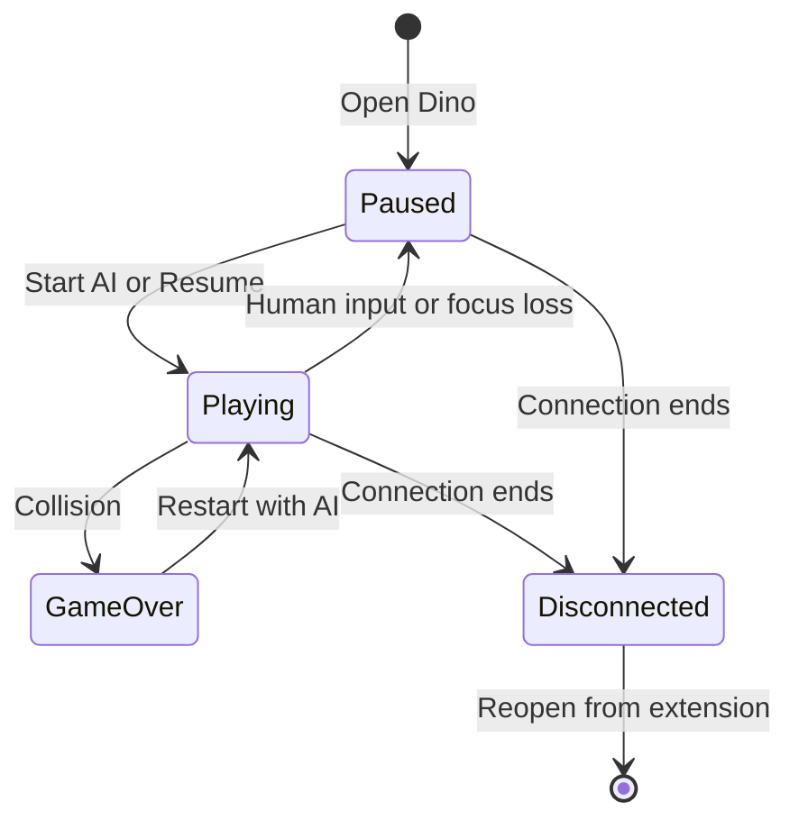

# Extension design

The extension runs a saved DQN inside Chrome’s original offline Dinosaur game. Python trains; the extension only predicts actions. No server or game clone is needed.

## Opening the real game

```mermaid
sequenceDiagram
    actor User
    participant Worker as Extension worker
    participant Tab as Dedicated game tab
    User->>Worker: Open Dino
    Worker->>Tab: Create tab and attach debugger
    Worker->>Tab: Emulate offline; navigate to dino.invalid
    Tab-->>Worker: Native Dino ready; document identity
    Worker->>Tab: Install paused controller for this document
    User->>Tab: Start AI
    loop About every 50 ms while enabled
        Tab->>Tab: Read state → DQN → update held key
    end
    User->>Tab: Keyboard, pointer or wheel input
    Tab->>Tab: Release agent key; pause
    User->>Tab: Resume
```

Chrome blocks extension access to `chrome://dino`. The chosen route uses tab-scoped offline emulation and the reserved `https://dino.invalid/` placeholder. Chrome serves its own `chrome-error://chromewebdata/` page and `Runner` game. Other tabs remain online. This was tested on Chrome **157.0.8103.79**, macOS.

| Approach | Decision |
|---|---|
| Control `chrome://dino` | Blocked by Chrome |
| Dedicated native offline tab | Chosen: real game, no backend |
| Bundle a clone | Would not meet the native-game requirement |
| Python service/native host for inference | Unnecessary setup and processes |

## Responsibilities

| File | Owns |
|---|---|
| `background.js` | Created tab, debugger connection, model loading and heartbeat |
| `controller.js` | Game-page decisions, held key, explicit start/resume and manual takeover |
| `policy.js` | Pure observation conversion, Q calculation and model validation |
| `popup.*` | Open/return, status and disconnect |
| `../scripts/export_policy.py` | Deterministic Python-to-JSON export |

## Control lifecycle



Installation is **paused**. Only the page button authorizes automated input. Returning to a tab, a late worker reply or a heartbeat cannot start play. This also handles human input received before the controller exists.

Trusted keyboard, pointer and wheel events pause immediately, before input continues to the game. Only actual activation of the control button is exempt. Synthetic agent key events do not trigger takeover. The controller changes held keys only when its action changes and releases its key on pause. Page focus/visibility signals and Chrome active-tab/window events pause; none resume.

The worker captures the loaded document’s `performance.timeOrigin`. Installation rejects a replacement document, and navigation cancels an opening or active session. This prevents a delayed installation from taking over a reloaded game.

The worker pulses every **200 ms**. A gap over **500 ms** permanently expires that page controller: predictions stop, the key is released and Resume is disabled. A late pulse or human input cannot clear expiry. The user reopens Dino from the extension. This is a connection guard, not a gameplay heuristic. Disconnect destroys the controller; debugger cancellation stops it through expiry. Reloading the extension may leave a disabled panel until the game is reopened.

## Model and compatibility

The network is **28 → 64 → 64 → 3**, with ReLU hidden layers. Inference chooses the largest Q-value, with no exploration. Its 50 ms timer is a target cadence; browser scheduling can delay it.

The export includes float32 weights, normalization scales, schema, action order, interval, checkpoint step, ZIP SHA-256 and expected game settings. Before start/resume and during play, the controller checks the native error page, **600 × 150** game dimensions, and these exact settings from [`config.py`](../dino_rl/config.py):

| Object | Exact field values |
|---|---|
| Runner | `speed=6`, `maxSpeed=13`, `acceleration=0.001`, `clearTime=3000` |
| Dinosaur | `width=44`, `widthDuck=59`, `gravity=0.6`, `initialJumpVelocity=-10` |

Unknown settings or invalid observations stop control with a visible error. These checks cover the declared interface; they cannot prove a future Chrome release has identical internals.

## Permission and verification

The only manifest permission is **`debugger`**. Chrome displays its broad permission warning and debugging banner. Code attaches only to the game tab it creates; popup commands cannot supply an arbitrary website or tab ID. All code and weights are bundled. No accounts, analytics, remote scripts or cloud inference are used. Office policies are not changed.

Tests compare Python/JavaScript observations, Q-values and actions on **500 generated states**, verify the exported checksum, and exercise real Chrome controls. Browser regressions cover startup races, manual takeover, focus, navigation, disconnect, expired connections, dimensions and a separate tab remaining online. Tests use temporary profiles; the test loading flag is not part of normal user installation. See the [review record](review.md) and [model card](../models/README.md) for evidence and limits.

## References

- [Chrome debugger API](https://developer.chrome.com/docs/extensions/reference/api/debugger)
- [Chromium debugger access checks](https://github.com/chromium/chromium/blob/main/chrome/browser/extensions/api/debugger/debugger_api.cc)
- [DevTools extension loading for isolated tests](https://chromedevtools.github.io/devtools-protocol/tot/Extensions/)
