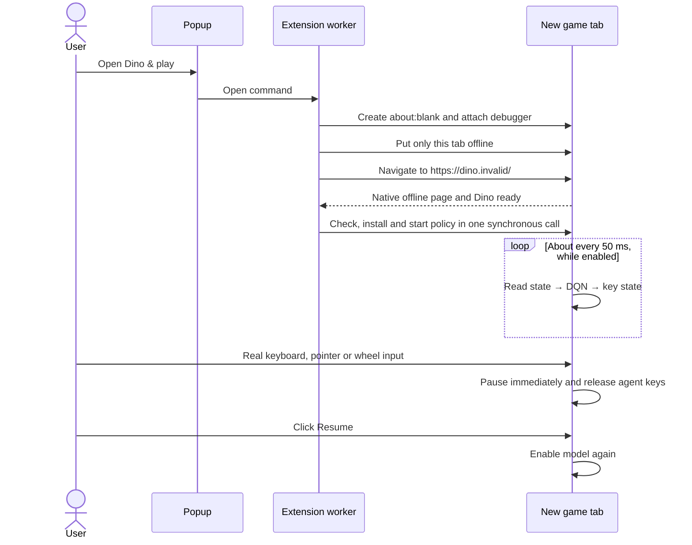
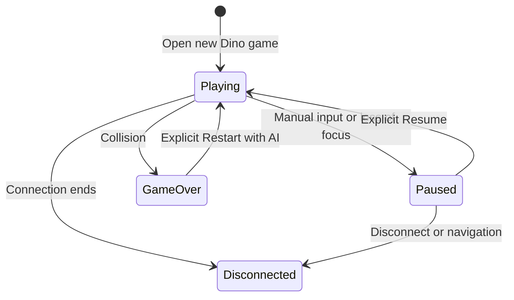

# Extension design

The extension runs the selected DQN inside Chrome’s own offline Dinosaur game. Python trains the model; the extension only uses its saved weights. Game physics, obstacle generation, collisions and speed remain native.

## The supported route

Chrome denies extension access to `chrome://dino`, including via the debugger API. The chosen route opens a tab, attaches the debugger, enables offline emulation on that tab, and navigates to a reserved `.invalid` address. Chrome serves `chrome-error://chromewebdata/` with its original `Runner` game. This was verified in installed Chrome 157.0.8103.78 using an isolated profile.

| Approach considered | Decision and reason |
|---|---|
| Attach to `chrome://dino` | Rejected: Chrome blocks extension access |
| Dedicated native offline tab | Chosen: actual Chrome game, no backend, tab-scoped offline mode |
| Bundle a clone | Rejected: would not meet the native-game requirement |
| Local Python service or native-messaging host | Rejected: adds setup and processes that inference does not need |

No managed browser policy or security restriction is changed. The test suite’s extension-loading flag applies only to its temporary browser profile. Users install through Chrome’s normal **Load unpacked** flow, where permitted.

## Responsibilities

| File | Responsibility |
|---|---|
| `extension/background.js` | Own the created game tab, debugger connection, model loading and heartbeat |
| `extension/controller.js` | Run decisions in the game page and enforce manual takeover |
| `extension/policy.js` | Pure observation conversion, Q-value calculation and model validation |
| `extension/popup.*` | Open/return to the game, show status, and disconnect |
| `scripts/export_policy.py` | Export the selected Python policy into local JSON |
| `models/` | Inference model, provenance and completed validation results |

## Control rules

The popup has **Open Dino & play / Return to Dino** and **Disconnect**. The game page has **Pause / Resume / Restart with AI** as appropriate. Returning to an existing tab never resumes control automatically.

The page owns a synchronous `enabled` flag. Installation and the first resume happen in one synchronous page call, so a delayed worker reply cannot undo input received during opening. Trusted keyboard, pointer and wheel events pause control before the user’s input continues to the game. Only activation of the control button is exempt. Synthetic agent key events are not mistaken for human input. A delayed worker heartbeat can update connection health but cannot set `enabled` to true.

The agent sends key events only when its chosen key state changes. Pause releases only its own held key. Page focus/visibility events and Chrome’s active-tab/window events pause the agent. These signals never resume it. A collision stops it until an explicit restart; there is no automatic restart loop.

The worker pulses every **200 ms**. If pulses stop for **500 ms**, the page stops predictions, releases automated input and disables Resume. Resume cannot refresh connection health itself. A worker that later sees this expired state closes the session; the user must reopen Dino through the extension. This timeout is a connection guard, not an obstacle heuristic. Explicit disconnect destroys the controller and removes the panel. Navigation, tab closure and debugger cancellation also stop the connection. Closing or reloading the extension may leave the paused panel in an existing tab until it is reopened or refreshed.

## Model compatibility

The shipped network is **28 → 64 → 64 → 3**, with ReLU hidden layers. The extension chooses the largest Q-value with exploration disabled. Its nominal decision interval is **50 ms**. It has no hand-written obstacle avoidance rules.

The deterministic JSON export includes float32 weights, normalization scales, schema, action order, decision interval, source model SHA-256, game dimensions and expected physics settings. The page checks the native error-page origin, default 600 × 150 game dimensions, speed/acceleration settings and dinosaur physics before allowing play and during inference. Unsupported settings stop control with a visible error.

Every value below must match exactly before resume and during active inference. The source of these values is `dino_rl/config.py`; export copies them into the model contract.

| Runner field | Required value |
|---|---:|
| `speed` | 6 |
| `maxSpeed` | 13 |
| `acceleration` | 0.001 |
| `clearTime` | 3000 |

| Dinosaur field | Required value |
|---|---:|
| `width` | 44 |
| `widthDuck` | 59 |
| `gravity` | 0.6 |
| `initialJumpVelocity` | −10 |

The Python/JavaScript parity test compares observations exactly as float32, compares Q-values within a numerical tolerance, and requires matching actions on 500 generated states. It also verifies that the committed export is reproducible from the released ZIP.

## Permission and privacy boundary

The only manifest permission is **`debugger`**. Chrome displays a broad permission warning and a debugging banner. The implementation attaches only to the game tab it creates; it never accepts a supplied website URL or tab ID from the popup.

The model and executable code are bundled. There are no remote scripts, analytics, user accounts, cloud inference, shell commands, native host, or reads from the training directory. Offline emulation affects the attached tab only. The integration test opens an online local page in another tab to verify this boundary.

Office policies may prohibit installation or debugger access. Such an error is shown to the user. The extension does not attempt to bypass it.

## Verification

| Acceptance condition | Evidence |
|---|---|
| Real game, unchanged default physics | Native Chrome integration checks |
| Actual selected DQN, same actions as Python | Export checksum and numerical parity tests |
| Immediate human takeover; explicit resume | Keyboard, focused-button keyboard, pointer and wheel tests |
| Focus loss stays paused on return | Browser lifecycle test |
| Disconnect, navigation and debugger cancellation stop control | Browser lifecycle tests and prediction counters |
| Other tabs remain online | Tab-scoped offline integration test |
| Unsupported dimensions stop control | Resize compatibility test |
| Replay and machine paths stay out of the release | Packaging and staged-file inspection |

Python training and checkpoint code were also reviewed for learning-state continuity, replay ordering, worker cleanup and comparable evaluations. Findings and resolutions are in [the review record](review.md). The original draft’s implementation steps are complete when those checks and publication are recorded there.

## Sources

- [Chrome debugger API](https://developer.chrome.com/docs/extensions/reference/api/debugger): permission, tab attachment, restricted targets and connection lifecycle.
- [Chromium debugger implementation](https://github.com/chromium/chromium/blob/main/chrome/browser/extensions/api/debugger/debugger_api.cc): access restrictions.
- [Chrome DevTools Extensions domain](https://chromedevtools.github.io/devtools-protocol/tot/Extensions/): isolated test loading, separate from user installation.
