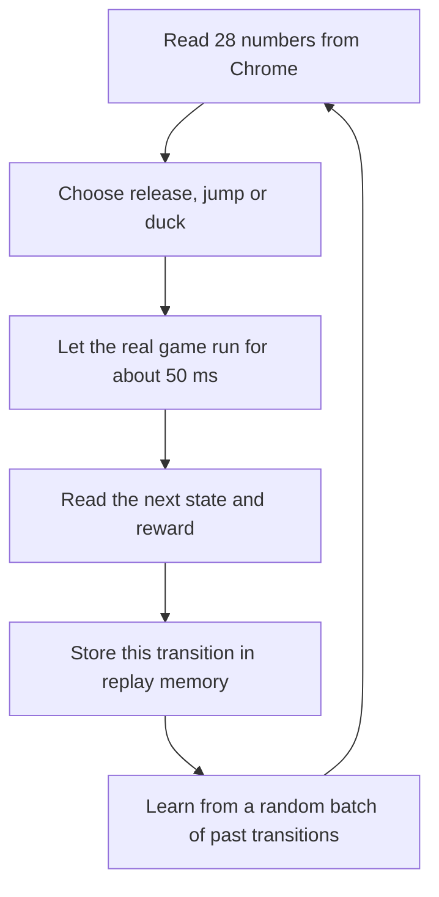
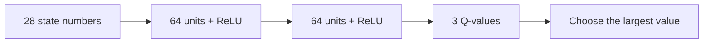

# How Dino learns

**Reinforcement learning (RL)** means learning by trying actions and seeing what happens. Here, a model repeatedly plays Dino. Staying alive earns reward; a crash loses reward. Training adjusts the model so actions that lead to better future outcomes become more likely.

You do not need to play or record a dataset. The training program connects the game to the learning algorithm and collects experience automatically.

## One learning loop



One stored transition is:

| Field | Simple meaning |
|---|---|
| Observation | What the game looked like as numbers before acting |
| Action | The selected key state |
| Reward | How much game time passed, minus a crash penalty if needed |
| Next observation | What the game looked like afterward |
| End flag | Whether the attempt ended; time caps are tracked separately |

Replay memory holds up to **100,000 transitions**. It is training data collected from the agent’s own play. It does **not** initialize the network’s weights. A fresh run starts with random weights. `--initialize-from` starts with a saved policy; `--resume` restores a full learning checkpoint.

## What the model sees

The observation is a float32 array with **28 values**. It comes from Chrome’s live `Runner` object through Playwright during Python training, or through the extension’s page controller during browser inference.

| Positions, starting at 0 | Values | Scaling |
|---|---|---|
| 0 | Current game speed | Divide by 14 |
| 1 | Dinosaur height above the ground | Divide by 150 |
| 2 | Vertical velocity | Divide by 20 |
| 3–6 | Jumping, ducking, speed-drop, and jumping after minimum height | 0 or 1 |
| 7–9 | Previous action as three indicator values | Exactly one is 1 |
| 10–18 | Nearest visible, unpassed obstacle | Nine values below |
| 19–27 | Second visible, unpassed obstacle | Same nine values |

Each obstacle contributes: present flag; horizontal gap from the dinosaur’s front edge ÷ 600; obstacle Y ÷ 150; width ÷ 600; height ÷ 150; approach speed ÷ 14; and three indicators for small cactus, large cactus or bird. Missing obstacles contribute nine zeros. Birds’ approach speed includes their native speed offset.

This is a compact description of the current game. The model does not receive the whole browser screen, an obstacle’s future position, a planned jump time, or a rule saying how to avoid a bird.

## What the model outputs



A **Q-value** estimates the future reward of taking an action now and then continuing with the policy. It is not a probability and does not need to be between 0 and 1.

| Action | Key behavior |
|---|---|
| Release | Release keys held by the agent |
| Jump | Hold Up |
| Duck | Hold Down; this also causes a faster drop while airborne |

Running is automatic in Dino. Holding Up across decisions produces a longer jump than releasing it early. The agent learns this timing by choosing key states repeatedly; there is no separate “jump height” output.

## How DQN changes the weights

**DQN** stands for **Deep Q-Network**. “Deep” refers to the neural network that predicts action values.

1. Collect transitions by playing the game.
2. Draw a random batch of **64** transitions from replay memory.
3. For each transition, build a target from the observed reward plus the estimated value of the next state.
4. Compare that target with the online network’s prediction for the action actually taken.
5. Use backpropagation and Adam to reduce the difference.

The standard one-step target is:

```text
target = reward + 0.995 × max Q_target(next_state, action)
```

For a real terminal crash, the future-value term is zero. A five-minute time cap ends the stored episode but is not a death; Stable-Baselines3 keeps the bootstrap term for that time limit.

DQN keeps a second, slower-changing **target network** to make the targets less unstable. Its weights are periodically copied from the online network. This project uses Stable-Baselines3’s ordinary DQN with Huber loss, Adam, a learning rate of **0.0001**, and target updates at a configured **1,000-transition** interval. Learning starts after **5,000 transitions**. There is one gradient update per four collected transitions; when several games run in parallel, gradient work scales with their combined data.

There is no imitation dataset, hand-coded obstacle policy, or bird-only curriculum. The reward is **+1 per second of actual game time** and **−10 on a crash**. The agent must survive long enough to meet later obstacles, including birds.

## Why some training actions are random

At first the model knows little. If it always repeated its current favorite action, it might never discover useful jumps or ducks. **Epsilon-greedy exploration** sometimes chooses a random action so it can try other possibilities.

| Stage | Behavior |
|---|---|
| Start of a fresh run | 100% random actions |
| First 50,000 absolute steps of that run | Random-action chance falls linearly |
| Later training | 5% by default; the released model used 1% |
| Evaluation and extension use | 0%; always choose the largest Q-value |

A 1% exploration rate means roughly one random choice in a hundred decisions. That choice may accidentally equal the model’s preferred action. It is a learning setting, not a claim that the model is 99% accurate. Resuming a run keeps its saved exploration setting unless explicitly overridden.

## Training and playing are different

| | Training | Evaluation / extension |
|---|---|---|
| Weights change? | Yes | No |
| Replay memory needed? | Yes | No |
| Random exploration? | Yes | No |
| Game time | Native Chrome time | Native Chrome time |
| Main output | Checkpoints and learning metrics | Actions and test results |

Python reads the state, predicts an action, applies it, and waits for the next nominal 50 ms boundary. Browser inference uses a page timer at the same nominal interval, which avoids a Python round trip. Both depend on real scheduling; 50 ms is a target cadence, not a guaranteed deadline.

## What to improve next

Freeze the selected model and collect more **visible, normal-speed games**, and extension games. Compare survival times, cactus collisions and bird outcomes. If failures repeat in a particular situation, first check the state/action mapping and timing. Then consider more ordinary training and compare new checkpoints on the same evaluation conditions.

A lower loss or more training steps alone is not evidence of better play. Keep the best evaluated checkpoint, and report the sample size and any test caps.
