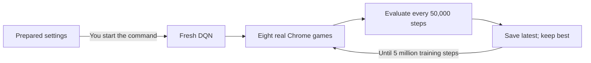

# Fresh five-million-step run

This recipe trains a new model from random weights. Use the start command for a new run and the resume command for an existing checkpoint. Current progress is recorded under `runs/dqn-scratch-5m/`; this document describes the procedure rather than live status.

## Start a new run

From the repository root:

```bash
uv run --frozen dino @configs/scratch-5m.args
```

The argument file uses Python's built-in command-line parser: one argument per line. It selects a new run at `runs/dqn-scratch-5m`. The learning settings come from `dino_rl/config.py`; the complete resolved configuration is written to the run's `config.json` when learning is initialized.

This command starts with **random weights, empty replay and a new optimizer**. It has neither `--resume` nor `--initialize-from`. The previous model and experiments stay in their own directories. Starting this command again after the new run has been initialized raises an error instead of overwriting it.



## The settings

These match the latest native-clock training configuration. The previous successful run used transferred weights. Reusing its settings for random initialization is a controlled new experiment, not proof that they are optimal for a fresh run.

| Setting | Prepared value | Meaning |
|---|---:|---|
| Total training steps | 5,000,000 | Combined transitions across all workers; evaluation steps are separate |
| Game workers | 8 | Eight independent background Chrome games |
| Network | 28 → 64 → 64 → 3 | Same observations, hidden layers and actions as the released model |
| Device / Torch threads | CPU / 1 | No GPU training |
| Learning rate | 0.0001 | Size of the weight updates |
| Discount factor | 0.995 | How future reward is valued |
| Replay capacity | 100,000 | Most recent collected transitions |
| Batch size | 64 | Transitions sampled for one gradient update |
| Learning warm-up | 5,000 steps | Collect experience before updating weights |
| Collection / updates | 4 vector steps / 8 updates | 32 transitions followed by 8 updates: one update per four transitions |
| Target network | Every 1,000 transitions | Hard copy of the online network |
| Exploration | 100% → 1% over the first 50,000 steps | Then stays at 1%; it does not reset at each checkpoint |
| Evaluation / saving | About every 50,000 steps | Same cadence as the latest run; collection finishes full vector rollouts |
| Evaluation games | 8 per checkpoint | Exploration off; weights frozen |
| Episode limit | 300 seconds | Time cap, not a death or the game's finish line |
| Python/model seed | 7 | Native Chrome obstacle randomness remains unseeded |
| Best-model metric | Median survival, then mean survival | Retains a better earlier checkpoint if later training regresses |

The original default for a new CLI run is 5% final exploration. This recipe explicitly selects the latest run's **1%**. The 50,000-step decay is also retained; it is not stretched to 10% of the new five-million-step target. If this fresh run stalls, inspect evaluation and encounter counts before deciding on a separate exploration experiment.

## What was checked

| Part | Check and decision |
|---|---|
| DQN theory | Ordinary one-step DQN: replay, target network, Huber loss, Adam and gradient clipping. No algorithm extensions added. |
| Training target | Observed reward plus discounted maximum next-state target Q-value; a crash removes the future-value term. |
| Episode endings | A crash is terminal; a time cap remains eligible for bootstrapping through Stable-Baselines3's timeout handling. |
| Real game | Native Chrome time and physics, with nominal 50 ms decisions. No simulated obstacles or bird-specific rules. |
| State and actions | Existing 28-value state; release / hold Up / hold Down. Holding and releasing keys lets the policy learn jump duration. |
| Parallel training | Eight updates per four vector steps keeps the same update-to-data ratio as one worker. Target updates account for all eight workers. |
| Fresh initialization | Regression inspects zero training steps, zero gradient updates, empty replay and optimizer state, expected network, and the exploration schedule before any learning. No checkpoint loader is called. |
| Resume and saving | Existing regressions cover learning-state restoration, replay ordering, independent selection conditions and cancelled evaluations. |
| Prepared command | CLI tests check all recipe arguments, absence of inherited weights, and explicit resume behavior without opening Chrome. |

The implementation was checked against the installed Stable-Baselines3 2.9.2 source and its [official DQN documentation](https://stable-baselines3.readthedocs.io/en/master/modules/dqn.html). Preparation checks include fresh-state initialization, command parsing and resume behavior. The fresh-state test uses lightweight test environments and stops before learning. These checks verify the mechanics; only the new run's measured results can establish how well it learns from scratch.

## Watch the run

In another terminal:

```bash
uv run --frozen tensorboard --logdir runs/dqn-scratch-5m/tensorboard --port 6006
```

Open **http://localhost:6006**. TensorBoard data appears after learning starts; initial Chrome setup and baseline games happen first.

| Graph | Look for |
|---|---|
| `eval/median_survival_seconds` | Main measure of improvement across several evaluations |
| `eval/mean_score` | Better scores in frozen-policy games |
| `rollout/exploration_rate` | Falls to 0.01 around step 50,000 and stays there |
| `birds/eval/encounters_y50`, `y75`, `y100` | Enough bird encounters to make the pass rates useful |
| `birds/eval/pass_rate_y50` and other heights | Passed / (passed + collided); not a whole-game accuracy |
| `resources/transitions_per_second` | Actual collection throughput on this laptop |

The console also reports progress. JSON episode/evaluation logs, TensorBoard events and checkpoints stay under this run directory and are ignored by Git.

When Codex starts the run in the background, console output goes to `runs/dqn-scratch-5m/train.log`. The trainer PID, process creation time and starting Git commit are saved in `process.json`. The existing TensorBoard server can display this run without starting a second server.

## Stop and resume later

For a foreground run, press **Ctrl+C once** during learning or checkpoint evaluation. The process finishes the current worker step and saves `latest.json`. A cancelled evaluation cannot replace `best.json`. For a run started by Codex in the background, ask Codex to stop it; the recorded PID and creation time identify the correct trainer before sending the same interrupt signal.

After a checkpoint exists, resume with:

```bash
uv run --frozen dino @configs/scratch-5m.args --resume runs/dqn-scratch-5m/latest.json
```

This continues toward **five million total steps**, rather than adding five million more. Weights, replay, optimizer and saved Python/NumPy/Torch random states are restored. Native browser trajectories are not reproduced exactly.

## After a Chrome patch update

Normal resume rejects a different Chrome version. Run `uv run --frozen dino check` first and review the result. The environment checks game dimensions, runner settings and dinosaur physics; the movement check exercises the real controls, collisions and timing. A passing check supports an explicit patch-version transition, not a claim that all browser internals are identical.

For the verified `.78` → `.79` update, full-state continuation uses:

```bash
uv run --frozen dino @configs/scratch-5m.args --run runs/dqn-scratch-5m-chrome79 --resume runs/dqn-scratch-5m/latest.json --accept-chrome-version 157.0.8103.79
```

The one-time flag accepts only the exact installed version within the same Chrome major/minor/build. Every other contract field must still match. A new run directory is required so evaluation selection starts separately; the old checkpoints and best model remain untouched. The new configuration records the browser change. Weights, optimizer, replay and random-generator state are retained, including replay collected under the verified previous patch.

After this continuation has saved a checkpoint, resume it without the one-time flag:

```bash
uv run --frozen dino @configs/scratch-5m.args --run runs/dqn-scratch-5m-chrome79 --resume runs/dqn-scratch-5m-chrome79/latest.json
```

For runs launched by Codex, `runs/current-training.json` identifies the current run directory; its `process.json` identifies the trainer. TensorBoard shows the continuation as a separate run. Compare its evaluations with the original run while keeping the browser-version difference visible.

Eight Chrome games are the same workload used previously; there is no hard CPU cap. Resource metrics are sampled estimates. Choose a time when the laptop can remain awake and ventilated. Sleep suspends local training; this setup does not change power settings or office policies.

At the ideal eight-games × 20-decisions/second rate, collecting five million transitions alone takes about **8.7 hours**. The approximately 100 eight-game evaluation batches and normal overhead add time. A batch where all eight games reach their cap adds roughly five minutes of gameplay. Plan for a long session, not a guaranteed completion time.

Each recent full checkpoint occupied about **24.5 MB** locally. Around 100 such checkpoints would use roughly **2.5 GB**, plus logs and reports. Existing experiments are retained; no automatic deletion is configured.

## After training

Freeze this run's selected `best.json` and test it in separate visible native-speed games. Then benchmark it through the extension. Compare survival, scores and obstacle outcomes with the released model before replacing that release. Five million training steps do not by themselves guarantee better or perfect play.

```bash
uv run --frozen dino evaluate --checkpoint runs/dqn-scratch-5m/best.json --show-browser --episodes 10 --run runs/dqn-scratch-5m-visible-test
```
