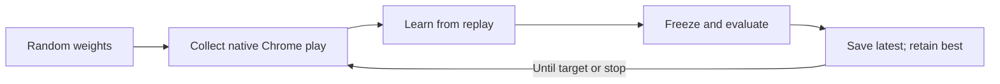

# Training and evaluation

Training collects its own data from live Chrome Dino games. No human recordings are needed. A fresh run starts with random weights; a resume restores a saved learning checkpoint.

## Start a run

Install the dependencies and run the game check as shown in the [README](../README.md#train-or-evaluate). Start small to check laptop load:

```bash
uv run --frozen dino train --run runs/my-first-run --workers 1 --steps 20000
```

The saved five-million-step recipe uses eight background games:

```bash
uv run --frozen dino @configs/scratch-5m.args --run runs/my-new-5m-run
```

Use a new directory. Starting over an initialized run is rejected. The recipe has neither `--resume` nor `--initialize-from`: weights, replay and optimizer start fresh. `--steps` is the total target, not extra steps to add. Combined transitions from all workers count toward it; evaluation does not.



## Recipe settings

These are a reproducible starting point, not proven optimal settings. Full resolved settings go to the run’s `config.json`; algorithm defaults live in [`dino_rl/config.py`](../dino_rl/config.py).

| Setting | Value | Meaning |
|---|---:|---|
| Target | 5,000,000 | Total training transitions |
| Workers / Torch threads | 8 / 1 | Parallel real games; CPU model updates |
| Network | 28 → 64 → 64 → 3 | State numbers to action values |
| Learning rate / discount | 0.0001 / 0.995 | Update size / value of future reward |
| Replay / batch size | 100,000 / 64 | Stored transitions / sample per update |
| Warm-up | 5,000 | Collect before learning |
| Collection / updates | 4 vector steps / 8 updates | One gradient update per four transitions |
| Target copy | Every 1,000 transitions | Refresh the target network |
| Exploration | 100% → 1% over 50,000 steps | Then stays at 1% during training |
| Evaluate / save | About every 50,000 steps | Eight frozen-policy games |
| Episode cap | 300 game seconds | Time limit, not a crash |
| Selection | Median survival, then mean | Earlier checkpoints can remain best |
| Python/model seed | 7 | Does not seed native obstacle generation |

The ordinary CLI default is 5% final exploration; this recipe explicitly sets 1%. Evaluation always disables exploration. Decisions target 50 ms intervals; native physics and obstacle generation are unchanged. The [algorithm guide](how-it-works.md) explains the DQN target and timeout handling.

Choose 1, 2, 4 or 8 workers to suit the computer. More workers do not accelerate game physics. Eight workers have no hard CPU cap; telemetry is sampled. Five million transitions alone take at least about 8.7 hours at the ideal 8 × 20 decisions/second, with evaluations and overhead adding time. Full checkpoints need several gigabytes over a long study. Laptop sleep suspends training; no power or office policies are changed.

## Stop and resume

During learning or checkpoint evaluation, press **Ctrl+C once**. Training finishes its short collection batch, commits the transitions and saves `latest.json`. A cancelled evaluation is discarded and cannot replace `best.json`. During setup/baselines, Ctrl+C exits before learning starts. Hard termination can lose work since the last checkpoint.

```bash
uv run --frozen dino @configs/scratch-5m.args --run runs/my-new-5m-run --resume runs/my-new-5m-run/latest.json
```

| Option | Restores |
|---|---|
| `--resume runs/.../latest.json` | Weights, target, optimizer, replay, counters and saved random-generator states |
| `--initialize-from models/best.json` | Policy/target weights only; new replay and optimizer |

The public inference model cannot be resumed because it has no replay or random-generator snapshot. New checkpoints include Python, NumPy, Torch and action-space random states. Historical checkpoints without the last state print a warning. Native browser restarts and scheduling prevent exact trajectory reproduction even with complete saved random states.

Same-run resume requires the same browser mode and episode cap. Changing worker count preserves replay order and adjusts learning work to the new data rate.

## Chrome updates

Normal Python resume/evaluation rejects a changed Chrome version. First run:

```bash
uv run --frozen dino check
```

Review the movement, timing and game-contract result. After a verified **patch-only** update, explicitly continue into a new directory so model selection stays separate. For example, the reviewed `.78` → `.79` transition was:

```bash
uv run --frozen dino @configs/scratch-5m.args --run runs/dqn-scratch-5m-chrome79 --resume runs/dqn-scratch-5m/latest.json --accept-chrome-version 157.0.8103.79
```

The flag accepts only that exact installed version within the same major/minor/build. Other contract fields must match. Later resumes use the new run’s `latest.json` without the flag. Existing replay from the verified earlier patch is retained; the configuration records the transition.

## Read the graphs

```bash
uv run --frozen tensorboard --logdir runs --port 6006
```

Open **http://localhost:6006** and select your run. The horizontal axis is training steps. Initial baseline games run before training graphs appear.

| TensorBoard graph | Interpretation |
|---|---|
| `eval/median_survival_seconds` | Main selection result; compare several batches |
| `eval/mean_score` | Score with weights frozen and random actions off |
| `rollout/ep_rew_mean` | Training reward, including exploration mistakes |
| `rollout/exploration_rate` | Random-action chance, not model error rate |
| `train/loss` | Q-value prediction error; lower alone does not prove better play |
| `birds/eval/encounters_y50`, `y75`, `y100` | Bird samples at each native height |
| `birds/eval/pass_rate_y50` and other heights | Passed / (passed + collided); unresolved birds excluded |
| `resources/transitions_per_second` | Collection throughput |
| `test/headless/*`, `test/visible/*` | Separate tests run with `dino evaluate` |

Evaluation is the validation-like check. Games that choose `best.json` are selection data; a separate frozen-policy benchmark is needed for a final check. Random native obstacles mean scores vary.

## Evaluate and export

```bash
uv run --frozen dino evaluate --checkpoint runs/my-new-5m-run/best.json --episodes 10 --run runs/my-test
uv run --frozen dino play --checkpoint runs/my-new-5m-run/best.json --episodes 3 --run runs/my-demo
uv run --frozen python scripts/export_policy.py --checkpoint runs/my-new-5m-run/best.json --output extension/model.json
```

The exporter checks the 28 → 64 → 64 → 3 network, observation schema, action order and decision interval. Reload the extension and open a fresh game to use a new export. It is independent of Python during play. Only load model/checkpoint files you trust.

Local runs contain replay, full checkpoints, JSON reports and TensorBoard logs. They stay ignored by Git. The repository publishes only the selected inference model, compact provenance and measured release results.

## Recorded study

The five-million-step study saved **4,198,264 transitions** before stopping after native render stalls; it did not complete five million. Later checkpoints were not consistently better. The released **1,250,400-step** model was selected by a fresh three-policy comparison. See the [model card](../models/README.md) for current results; this recipe is not a promise of perfect play.
