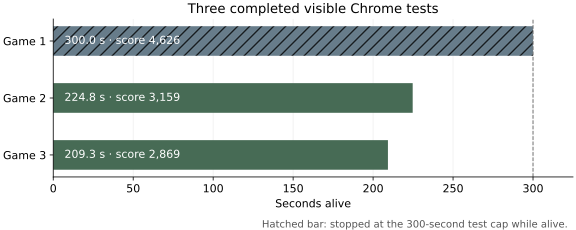

# Released model

This is a trained **DQN** for the default desktop Chrome Dinosaur game. It reads 28 game-state numbers and chooses release, jump, or duck about 20 times per second.

| Item | Value |
|---|---|
| Selected checkpoint | 1,500,576 steps in the latest run |
| Latest run length | 2,000,000 steps |
| Earlier training before that run | 106,038 steps; transferred policy weights |
| Network | 28 inputs → 64 ReLU → 64 ReLU → 3 Q-values |
| Training | CPU, eight native Chrome games, ordinary game time |
| Training exploration | Reduced to 1% late in the run |
| Evaluation / extension exploration | 0%; choose the largest Q-value |
| Tested Chrome | 157.0.8103.78, macOS |
| State schema | `dino-state-28-v1` |
| Source framework versions | Torch 2.15.0, Stable-Baselines3 2.9.2 |

The most recent checkpoint performed worse than the selected checkpoint. `best.json` points to the selected model. “Best” means best observed median survival in the run’s eight-game evaluations; it does not mean optimal or unbeatable.

## Files

| File | Purpose |
|---|---|
| [`best.json`](best.json) | Pointer used by the Python CLI |
| [`dqn/model.zip`](dqn/model.zip) | Trusted local Stable-Baselines3 inference model |
| [`dqn/metadata.json`](dqn/metadata.json) | Training settings, versions, selection results and SHA-256 |
| [`validation.json`](validation.json) | Three completed visible normal-speed validation games |
| [`../extension/model.json`](../extension/model.json) | Deterministic JavaScript export of the same weights |

The ZIP was re-saved to remove local machine paths and transient training observations. All policy and target-network weights were checked against the selected source checkpoint and are unchanged. The exported JSON records the released ZIP’s SHA-256. Replay buffers, random-generator state, browser profiles and full training logs are not included.

Use this release for inference or `--initialize-from`. Exact training continuation needs a full checkpoint from a local `runs/` directory and `--resume`. Only load Python model/replay files you trust.

## Observed performance

| Condition | Completed games | Median survival | Mean score | Five-minute cap reached |
|---|---:|---:|---:|---:|
| Headless native-clock checkpoint selection | 8 | 247.3 s | 3,470.3 | 0 |
| Separate visible native-clock check | 3 | 224.8 s | 3,551.3 | 1 |

| Visible game | Survival | Score | End |
|---|---:|---:|---|
| 1 | 300.03 s | 4,626 | Test stopped at its time cap while alive |
| 2 | 224.76 s | 3,159 | Large cactus collision while descending |
| 3 | 209.28 s | 2,869 | Large cactus collision while descending |

Ten visible games were planned. The user stopped the evaluation after three completed games; the interrupted fourth game is excluded.

During the selection games, 427 birds were passed and one caused a collision; one other bird was unresolved when a game ended. During the three visible games, 166 birds were passed and none caused a collision; one was unresolved. These are encounter counts from a small sample, not an estimate of perfect bird handling.

## Limits

- This is state-based RL: it reads the native game’s live variables. It is not a vision model or a general game-playing agent.
- It still crashes, especially around some cactus/jump timings. Longer training does not guarantee improvement.
- Scores above come from Python-controlled Chrome. The extension uses the same policy and passes numerical parity and lifecycle tests, but has not had a long score benchmark.
- Only three separate visible games finished. A larger fixed-policy test is needed before stronger claims about reliability.
- A 300-second cap is an evaluation stopping rule, not the game’s finish line.
- Actual decision timing depends on browser scheduling and computer load. Switching tabs pauses extension control.
- Chrome updates can change its internal game interface. The extension checks dimensions/physics settings; Python also requires the saved Chrome version.
- Native obstacle generation is not fully seeded. A fixed Python seed does not reproduce an identical obstacle sequence.

No cloud service or paid hardware is needed to use this model. Training and inference stay on your computer.
