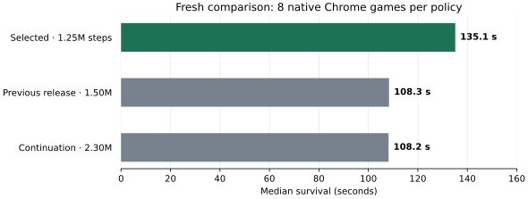

# Released model

The bundled DQN plays the default desktop Chrome Dinosaur game using **28 state numbers**, rather than screenshots. It chooses release, hold Up or hold Down about every 50 ms.

## Provenance

| Item | Value |
|---|---|
| Release | 0.2.0, November 19, 2026 |
| Selected checkpoint | **1,250,400 training transitions** |
| Initialization | Random weights; no imported policy |
| Network | 28 → 64 ReLU → 64 ReLU → 3 Q-values |
| Training browser | Chrome 157.0.8103.78 |
| Release tests | Chrome 157.0.8103.79 on macOS |
| Algorithm | Ordinary Stable-Baselines3 DQN; CPU, eight native-clock games |
| Late training exploration | 1% random actions |
| Evaluation / extension exploration | 0% |
| State schema | `dino-state-28-v1` |
| Source framework versions | Torch 2.15.0; Stable-Baselines3 2.9.2 |

The five-million-step study continued beyond this policy and saved **4,198,264 steps** before native render stalls stopped it. The target was not completed. Newer checkpoints were not consistently stronger. The selected policy had the highest median survival in the fresh comparison below; “best” is limited to that measured comparison.

## Files

| File | Purpose |
|---|---|
| [`best.json`](best.json) | Python release pointer |
| [`dqn/model.zip`](dqn/model.zip) | Small Stable-Baselines3 inference model |
| [`dqn/metadata.json`](dqn/metadata.json) | Settings, training/tested-browser provenance and checksums |
| [`validation.json`](validation.json) | Compact comparison and separate extension results |
| [`../extension/model.json`](../extension/model.json) | The same policy exported for JavaScript |

The inference ZIP removes local paths, transient observations and Adam optimizer moments. Every policy and target-network weight was compared with the selected source and is unchanged. Its SHA-256 is stored in both metadata and the JavaScript export. Python/JavaScript parity is checked on 500 generated states, including identical selected actions.

Replay, random-generator snapshots, browser profiles and full training logs are excluded. Use the release for inference or `--initialize-from`; `--resume` needs a full local training checkpoint. Only load Python model/replay files you trust.

## Fresh model comparison

All three policies used frozen weights, no exploration, eight background native Chrome workers and a 300-second cap. Different random obstacle sequences were generated by Chrome. Median survival chose the release; mean survival breaks ties.

| Policy | Games | Median survival | Mean survival | Mean score | Cap reached |
|---|---:|---:|---:|---:|---:|
| **Selected: 1,250,400 steps** | 8 | **135.1 s** | 136.1 s | **2,069.9** | 0/8 |
| Previous release: 1,500,576 steps | 8 | 108.3 s | 105.0 s | 1,450.6 | 0/8 |
| Continuation: 2,297,656 steps | 8 | 108.2 s | 112.4 s | 1,606.3 | 0/8 |

These games are **selection data**, not an independent final validation. Historical training-time scores were higher; they are not substituted for these fresh results. The small samples and different native obstacles do not establish statistical superiority or a maximum score.

Bird handling remains a weakness. Across the selected policy’s eight selection games, the game-Y=50 birds had **84 passes and 7 collisions**, Y=75 had **77 passes and 1 collision**, and Y=100 had **86 passes and no collisions**. Counts and per-game survival/score records are in `validation.json`. An encounter may remain unresolved when a game ends.

## Separate extension benchmark

The extension benchmark uses new games after selection, with the bundled JSON and no Python action loop. It runs in three independent temporary background Chrome profiles, with a 300-second cap per game. Completed measurements are recorded under `extension_benchmark` in [`validation.json`](validation.json).

| Game | Survival | Score | End |
|---|---:|---:|---|
| 1 | 300.34 s | 5,564 | Alive at test cap |
| 2 | 300.34 s | 5,564 | Alive at test cap |
| 3 | 286.41 s | 5,293 | Collision |

Median survival was **300.34 seconds**; mean score was **5,473.7**. The cap is checked at half-second intervals, so a small overshoot is expected. These three extension games are separate from the eight-game Python selection batches, with a different control runtime and workload. Do not pool their results or interpret two capped games as perfect play.

## Limits

- It still crashes. More training steps do not guarantee better performance.
- This is state-based Dino RL, not a vision model or general game-playing agent.
- Background tests do not establish visible-window performance on every computer. Browser load and scheduling affect the 50 ms decision cadence.
- A 300-second cap is a test stopping rule, not the game’s finish line.
- Native obstacles are unseeded. A fixed Python seed cannot reproduce a browser trajectory exactly.
- The extension checks the declared game dimensions and physics. Later Chrome versions can change internals; Python also checks the recorded browser version.

All training and inference stay on the local computer. See the [training guide](../docs/training.md) and [review record](../docs/review.md).
